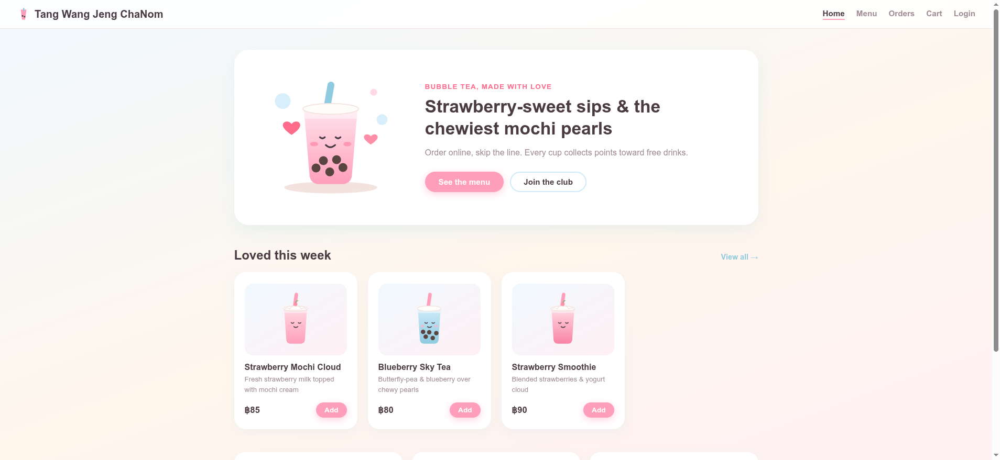
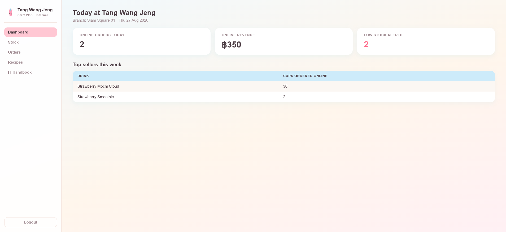
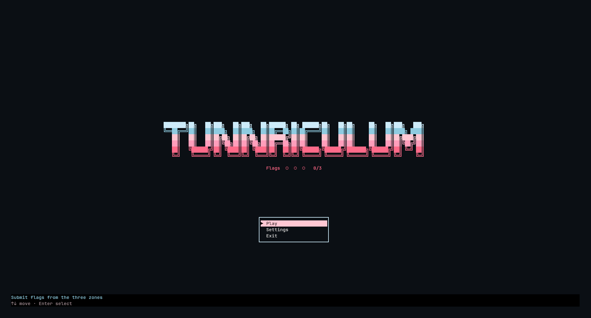
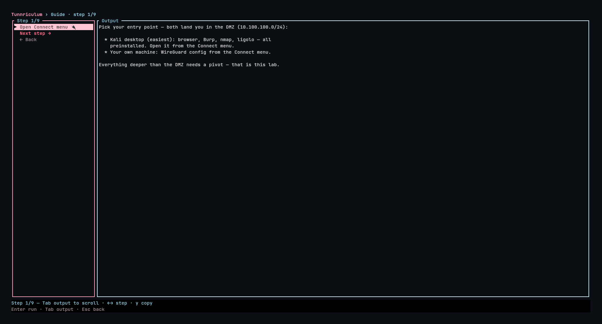
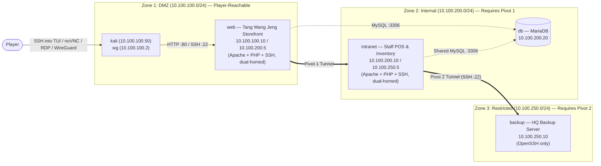

# Tunnriculum

A self-hosted, three-zone container network lab for practicing **network pivoting and multi-hop tunneling**. The scenario models **Tang Wang Jeng**, a bubble-tea franchise split across three isolated subnets (`DMZ` → `Internal` → `Restricted`). Application vulnerabilities are kept simple by design so the focus stays on network discovery, routing, and multi-hop tunneling (`ssh -D`, `ssh -L`, `ssh -J`, `sshuttle`, `ligolo-ng`).

> ### Project Status: Unfinished / Archived
>
> This repository was developed as a Computer Science final project and **discontinued before the full platform scope was completed**.
>
> - **What was built (this repository):** The complete **Three-Zone Learning Lab** (`web`, `db`, `intranet`, `backup`, `wg`, `kali`), the **`labctl` Rust TUI console** (interactive 9-step branching guide, flag checker, Kali/WireGuard connection helpers, and PIN-locked lifecycle controls), and the **Debian 12 VM appliance** provisioning scripts.
> - **What was dropped and why:** The original scope included a multi-tenant web portal (spawning up to 20 per-user lab slots), a separate 90-minute unguided exam scenario, and PDF certificate issuance. Orchestrating multi-slot isolated networks and per-user WireGuard routing from a web server proved fragile before the core lab itself was solid, so we pivoted to packaging a single, self-contained VM appliance driven through an SSH TUI (`labctl`). Development ended after completing the training appliance, and the unfinished web portal / exam skeletons were removed.

---

## Screenshots

| Storefront (Zone 1: DMZ) | Staff POS (Zone 2: Internal) |
| --- | --- |
|  |  |

| `labctl` Rust TUI Console | Interactive Step-by-Step Guide |
| --- | --- |
|  |  |

---

## How It Works (VM Appliance + SSH TUI)

The lab is designed to be deployed into a **Debian 12 VM**. Once provisioned:
1. You SSH into the VM as the player account (`ssh tunnriculum@<VM_IP>`).
2. Instead of a bash shell, your login session opens the **`labctl` Rust TUI console** (`/usr/local/bin/labctl`).
3. From inside the TUI, you can:
   - **Open a shell inside the built-in Kali container** (`Play → Connect → SSH into Kali`) or view browser **noVNC** (`http://<VM_IP>:6080/vnc.html`), **RDP** (`:3389`), and **WireGuard** (`peer1.conf`) connection details.
   - **Follow the interactive 9-step walkthrough** (`Play → Guide`), which adapts later steps to whichever tool you pick (`Burp` vs `curl`, `ssh -D` vs `ssh -L` vs `sshuttle` vs `ligolo-ng`).
   - **Submit and verify flags** (`Play → Submit flags`) for all 3 zones.
   - **Manage the lab stack** (`Settings`, PIN `1337`): start, stop, restart, reset, run the topology smoke test, or view live container logs.

---

## Network Architecture



| Zone | Subnet | Containers | Role |
| --- | --- | --- | --- |
| **DMZ** | `10.100.100.0/24` | `kali`, `wg`, `web` | Player entry point (built-in Kali container or WireGuard) and public Tang Wang Jeng storefront |
| **Internal** | `10.100.200.0/24` (`internal: true`) | `web`, `db`, `intranet` | Shared MariaDB (`chanom` database) and internal Staff POS |
| **Restricted** | `10.100.250.0/24` (`internal: true`) | `intranet`, `backup` | HQ Backup server reachable only via a second pivot from `intranet` |

---

## Intended Kill Chain

1. **Enter the DMZ**: Connect via `labctl` (`SSH into Kali`, browser `noVNC`, or `WireGuard`) and scan `10.100.100.0/24`.
2. **Initial Access (`web` — Flag 1)**: Register on `http://10.100.100.10`, place an order, and upload a PHP web shell on `pay.php` (which trusts `Content-Type: image/*` and uses an incomplete extension blacklist that misses `.php`). Read `/home/flag1.txt`.
3. **First Pivot (DMZ → Internal)**: Read `/var/www/html/config.php` to find `DB_PASS`, which is reused for SSH user `webadmin`. Spot the second interface (`10.100.200.5`) and open a tunnel into `10.100.200.0/24` (`ssh -D`, `ssh -L`, `sshuttle`, or `ligolo-ng`).
4. **Internal POS (`intranet` — Flag 2)**: Log into `http://10.100.200.10` as `staff` with the reused password (orders placed on the storefront appear here in real time). SSH to `posadmin@10.100.200.10` to read `/home/posadmin/flag2.txt`.
5. **Second Pivot (Internal → Restricted — Flag 3)**: Read the temporary HQ backup credentials (`backup` + `BACKUP_PASS`) from the POS IT Handbook (`wiki.php`), pivot through `intranet` into `10.100.250.0/24`, and SSH to `backup@10.100.250.10` to read `/home/backup/flag3.txt` and `/home/backup/sales_backup_2026.sql`.

For example, using standard OpenSSH proxy jumps across both hops:
```bash
ssh -J webadmin@10.100.100.10,posadmin@10.100.200.10 backup@10.100.250.10
```

---

## Setup & Usage

### Method 1: Deploy into a Debian 12 VM & Play via SSH TUI (Recommended)

Prepare a fresh **Debian 12 VM** (VirtualBox, VMware, Proxmox, or KVM/libvirt — 2 vCPU, 4 GB RAM, 20 GB disk) with OpenSSH server installed and a user with `sudo` access.

You can provision the VM **either by SSHing into the VM and cloning the repo inside it**, or **by pushing from your host machine**:

#### Option A — Run directly inside the VM
SSH into your Debian 12 VM, clone the repository, and run `provision-vm.sh`:

```bash
git clone https://github.com/c0ffeeOverdose/tunnriculum-lab.git ~/tunnriculum-lab
cd ~/tunnriculum-lab
./train/scripts/appliance/provision-vm.sh
```

#### Option B — Push from your host machine into the VM over SSH
From your host machine, point `provision-vm.sh` at your VM's SSH user and IP:

```bash
ssh-copy-id lab@<VM_IP>
./train/scripts/appliance/provision-vm.sh lab@<VM_IP>
```

#### What `provision-vm.sh` does automatically:
1. Installs `docker.io`, `docker-compose`, `rsync`, `sudo`, and `qemu-guest-agent`.
2. Creates the `lab` admin user and the restricted `tunnriculum` player user (password: `tunnriculum`, login shell set to `/usr/local/bin/labctl`, with a `sudoers` rule allowing only `/home/lab/tunnriculum/train/scripts/lab.sh *`).
3. Compiles a static musl `labctl` binary inside a `rust:alpine` container and installs it to `/usr/local/bin/labctl`.
4. Enables and starts `tunnriculum-firstboot.service` and `tunnriculum-lab.service`, which generate random flags/passwords (`train/instances/tunnriculum.env`) and build/start all 6 lab containers.

#### Enter the Lab TUI
Once provisioning finishes, SSH into the VM as `tunnriculum`:

```bash
ssh tunnriculum@<VM_IP>
```
*(Default password if not using an SSH key: `tunnriculum` · Settings PIN: `1337`)*

This opens the **`labctl` TUI** directly. From the TUI:
- Go to **`Play → Connect → SSH into Kali`** to drop straight into the Kali container shell in the DMZ, or open **`http://<VM_IP>:6080/vnc.html`** in your browser for the full Kali XFCE desktop.
- Go to **`Play → Guide`** for the step-by-step walkthrough.
- Go to **`Play → Submit flags`** to verify `FLAG1..3`.

---

### Method 2: Run Manually with Docker (Without Full VM Provisioning)

If you just want to spin up the 6 containers and run the TUI binary directly on a Linux machine that already has Docker installed:

```bash
# 1. Generate randomized flags, passwords, and Kali SSH keypair
./train/scripts/lab.sh init

# 2. Build and start all containers (wg, kali, web, db, intranet, backup)
./train/scripts/lab.sh up

# 3. Verify network segmentation rules
./train/scripts/lab.sh smoke

# 4. Print Kali desktop (noVNC / RDP / SSH) connection details
./train/scripts/lab.sh kali
```

To build and launch the `labctl` TUI binary locally:

```bash
docker run --rm --network=host -v "$PWD/train/labctl-rs:/labctl" -w /labctl \
  docker.io/library/rust:alpine cargo build --release

./train/labctl-rs/target/release/labctl
```

#### Useful `lab.sh` CLI Commands
| Command | Description |
| --- | --- |
| `./train/scripts/lab.sh status` | Show container states and ports |
| `./train/scripts/lab.sh logs` | Show the last 100 lines of container logs |
| `./train/scripts/lab.sh flags` | Print the generated `FLAG1..3` values |
| `./train/scripts/lab.sh peer <IP>` | Output a client WireGuard config (`peer1.conf`) |
| `./train/scripts/lab.sh kali-restart` | Restart `kali` (preserves `/home/kali`) |
| `./train/scripts/lab.sh kali-reset` | Recreate `kali` with a fresh home directory |
| `./train/scripts/lab.sh reset` | Wipe volumes and recreate containers (keeps current flags) |
| `./train/scripts/lab.sh down` | Stop and remove all containers, networks, and volumes |

---

## Testing `labctl`

```bash
# 16 Rust unit tests (guide parser, scroll tail-following, confirm modal, flag parser)
docker run --rm --network=host -v "$PWD/train/labctl-rs:/labctl" -w /labctl \
  docker.io/library/rust:alpine cargo test

# End-to-end Python PTY tests (drives the compiled TUI binary in a pseudo-terminal)
LABCTL_BIN=./train/labctl-rs/target/release/labctl python3 ./train/labctl-rs/tests/pty_check.py
```

---

## Repository Structure

```text
train/
  labs/learning/          Docker Compose stack (web, db, intranet, backup, wg, kali)
  labctl-rs/              Rust ratatui TUI console (restricted login shell for players)
  scripts/
    lab.sh                  Instance lifecycle CLI (init, up, down, reset, smoke, peer, kali)
    vm-up.sh                Host helper for managing a local libvirt VM (tunnriculum-lab)
    appliance/              Debian 12 VM provisioning (provision-vm.sh, systemd units, build-image.sh)
  export/export.sh        Package a provisioned libvirt VM into a redistributable .qcow2 pack
  docs/tui-guide.txt      Interactive 9-step walkthrough loaded by labctl
docs/screenshots/       UI screenshots used in this README
```
